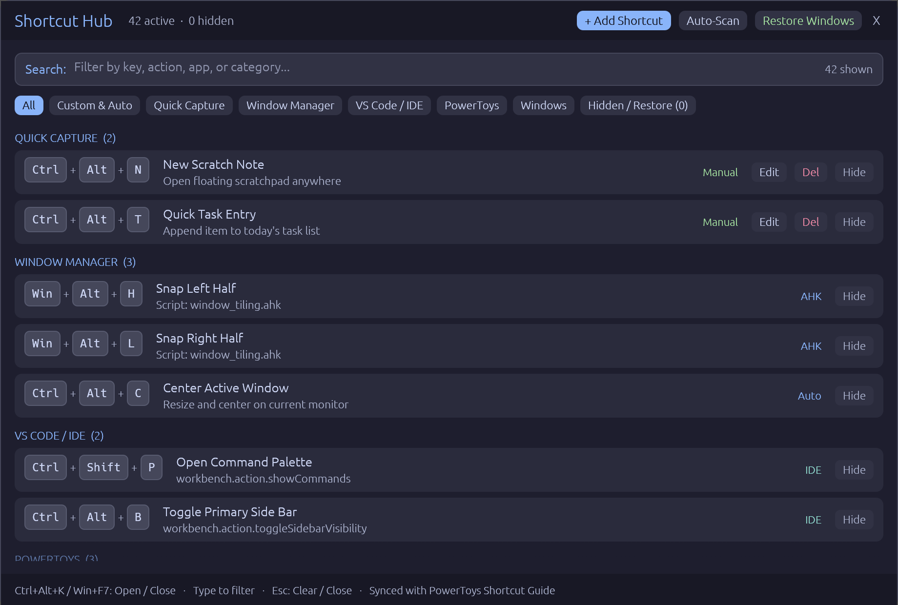
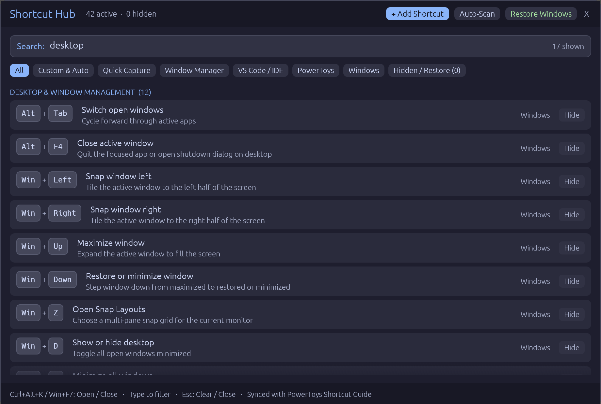
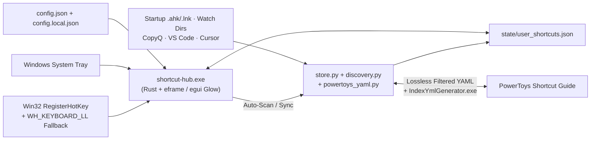

<div align="center">

# Shortcut Hub

**Instant GPU-accelerated global keyboard shortcut overlay, auto-discovery scanner, and PowerToys Shortcut Guide manager for Windows.**

[](https://github.com/dataflorian/shortcut-hub/releases/latest)
[](https://github.com/dataflorian/shortcut-hub/actions/workflows/ci.yml)
[](LICENSE)
[](native/Cargo.toml)
[-CBA6F7?style=for-the-badge)](https://github.com/dataflorian/shortcut-hub/releases)

[Features](#features) &bull; [Benchmarks](#performance) &bull; [Installation](#installation) &bull; [Usage](#usage) &bull; [Auto-Discovery](#automatic-shortcut-discovery) &bull; [Configuration](#configuration) &bull; [Architecture](#architecture)

<br/>



</div>

---

## Features

- **Instant Global Open & Close (`Ctrl+Alt+K` / `Win+F7`)** — Always-resident single-instance Windows tray daemon backed by Win32 `RegisterHotKey` (`MOD_NOREPEAT`), a `WH_KEYBOARD_LL` fallback, and focused `egui` input handling unified with an atomic 180 ms debounce guard. Press `Ctrl+Alt+K` (or `Win+F7`) from any app to open it, and press it again—or hit `Esc`—to close immediately.
- **GPU-Accelerated Native Rust UI** — Built with [`eframe`](https://github.com/emilk/egui/tree/master/crates/eframe) / `egui 0.37` (`glow` OpenGL backend) in a single ~6.5 MB release binary with zero Electron/WebView runtime bloat and crisp HiDPI keycap rendering.
- **Zero-Dependency Windows Catalog Included** — Ships with a built-in curated Windows 10/11 shortcut catalog out of the box, and automatically upgrades to the full native Windows manifest when Microsoft PowerToys is installed.
- **Automatic Shortcut Discovery** — Scans Windows Startup `.ahk` / `.lnk` scripts, configured automation folders, enabled PowerToys modules, CopyQ global/window commands, and VS Code / Cursor / Antigravity `keybindings.json`.
- **Add, Edit, Hide & Restore** — Add custom shortcuts into any existing or brand-new category using the built-in live **Record** key listener, hide noisy default Windows shortcuts you never use, and restore individual items or **Restore Windows** anytime.
- **Two-Way PowerToys Shortcut Guide Sync** — Keeps PowerToys `+Custom.MyShortcuts.en-US.yml` and filtered `+WindowsNT.Shell.en-US.yml` synchronized (backing up your original shell manifest before first modification and rebuilding the PowerToys search index automatically).

<div align="center">

</div>

---

## Performance

Measured on Windows 11 (`x86_64`, `200%` DPI scale, release binary `6.5 MB` with LTO):

| Operation | Measured Result | Notes |
| --- | --- | --- |
| Full catalog load (`117` items) | **`0.43 ms`** | Pure Rust YAML + JSON parser (`--bench`, 50-run avg) |
| Multi-token search filter (`117` items) | **`31.4 µs`** | Zero heap-thrashing per keystroke (`--bench`, 1,000-run avg) |
| Toggle latency | **Near-instant** | Already resident in tray; no cold process launch |
| Idle memory & CPU | **~0% idle CPU** | Repaints on demand; Win32 event + hotkey threads sleep until signaled |

*(The legacy Python/Tkinter fallback `overlay_ui.py` remains in the repository for reference, while the native Rust binary `shortcut-hub.exe` is the primary app.)*

---

## Installation

### Option 1: Pre-built Release Binary (Fastest)

1. Download **`shortcut-hub-windows-x86_64.zip`** from the [latest GitHub Release](https://github.com/dataflorian/shortcut-hub/releases/latest) and extract it to a permanent folder (e.g., `C:\Tools\ShortcutHub`).
2. Run the PowerShell setup script to create a Startup shortcut (optional Python discovery + PowerToys sync runs automatically if installed) and launch the tray app:
   ```powershell
   .\install.ps1
   ```
   Or double-click `shortcut-hub.exe` directly to run standalone with zero prerequisites.

### Option 2: PowerShell Installer from Cloned Repo

```powershell
git clone https://github.com/dataflorian/shortcut-hub.git
cd shortcut-hub
.\install.ps1
```

If `shortcut-hub.exe` is missing and Cargo is installed, `install.ps1` automatically compiles the release binary, syncs shortcuts (when Python is available), registers `%APPDATA%\...\Startup\ShortcutHub.lnk` (`--hidden`), and starts Shortcut Hub.

### Option 3: Build from Source

Requires the [Rust toolchain](https://rustup.rs/) (`stable-x86_64-pc-windows-msvc`) and optionally Python 3.10+ for auto-discovery/PowerToys sync.

```powershell
git clone https://github.com/dataflorian/shortcut-hub.git
cd shortcut-hub\native
cargo build --release
Copy-Item target\release\shortcut-hub.exe ..\shortcut-hub.exe -Force
cd ..
.\shortcut-hub.exe
```

---

## Usage

| Control | Action |
| --- | --- |
| **`Ctrl+Alt+K`** or **`Win+F7`** | Open the overlay from any app, or **close it when open** |
| **`Esc`** | Clear the search bar if non-empty, or close the overlay / modal |
| **Type anywhere** | Live multi-token search across keystrokes, names, descriptions, and categories |
| **Category chips** | One-click filter (`All`, `Custom & Auto`, custom categories, `PowerToys`, `Windows`, `Hidden / Restore`) |
| **`+ Add Shortcut`** | Create a custom shortcut with category presets and live **`Record`** key capture |
| **`Edit` / `Del` / `Hide`** | Modify manual entries or hide/restore any shortcut across Shortcut Hub and PowerToys |
| **`Auto-Scan`** | Re-scan Startup, automation folders, CopyQ, VS Code/Cursor/Antigravity, and PowerToys |
| **System tray icon** | Left-click to toggle; right-click for Toggle, Auto-Scan, Open Folder, and Quit |

<details>
<summary>CLI flags & diagnostic modes</summary>

| Flag | Description |
| --- | --- |
| `--hidden` | Start minimized to the system tray (used by Windows Startup `.lnk`) |
| `--project-dir <path>` | Override folder containing `config.json` and `state/` |
| `--bench` | Benchmark catalog loading (`ms`) and live filtering (`µs`) and exit |
| `--smoke-test` | Open GPU viewport, verify catalog & DPI scale, print diagnostics, and exit |
| `--screenshot <out.png>` | Render overlay and export a full-resolution RGBA PNG screenshot (`--filter`, `--search` supported) |

</details>

---

## Automatic Shortcut Discovery

Clicking **`Auto-Scan`** (or running `python store.py sync`) collects shortcuts from:

- **Windows Startup Folder** — `.ahk` scripts and `.lnk` shortcut targets inside `%APPDATA%\Microsoft\Windows\Start Menu\Programs\Startup`
- **Custom Automation Folders** — Any folders listed in `discovery.extra_watch_dirs` (including companion `config.json` hotkey maps)
- **PowerToys** — Enabled PowerToys modules (`Microsoft.PowerToys.en-US.yml`)
- **CopyQ** — `copyq-commands.ini` global and window shortcuts
- **IDEs** — Custom `keybindings.json` in VS Code, Cursor, and Antigravity

### Explicit `; @shortcut` Annotation Tag

For AutoHotkey scripts with dynamic or `Hotkey(...)`-registered bindings, add a structured comment anywhere in your `.ahk` file:

```autohotkey
; @shortcut [Research] Ctrl+Alt+R = Open ArXiv Search | Launches search overlay
```

Standard static `Hotkey::` definitions automatically inherit the comment line immediately above them.

---

## Configuration

Base defaults live in tracked [`config.json`](config.json). To customize paths, hotkeys, or category mappings **without dirtying git**, create a gitignored **`config.local.json`** in the root folder—Shortcut Hub deep-merges it automatically on startup:

```json
{
  "hotkeys": {
    "toggle_overlay": "^!k",
    "toggle_overlay_display": "Ctrl+Alt+K"
  },
  "discovery": {
    "extra_watch_dirs": [
      "C:\\Users\\YourName\\Scripts\\AutoHotkey"
    ],
    "category_hints": {
      "window-tiling": "Window Manager",
      "quick-notes": "Quick Capture"
    }
  }
}
```

<details>
<summary>All config.json options</summary>

- `hotkeys.toggle_overlay` / `toggle_overlay_alt` — AutoHotkey-style modifier notation (`^` Ctrl, `!` Alt, `+` Shift, `#` Win, e.g. `^!k`, `#F7`) paired with display strings.
- `powertoys.sync_enabled` — Set to `false` if you want to manage shortcuts only inside Shortcut Hub without touching PowerToys manifests.
- `discovery.ignore_dir_names` — Folder names skipped during recursive watch scans (`.git`, `node_modules`, `venv`, `target`, etc.).

</details>

---

## Architecture



---

## Uninstalling

Stop Shortcut Hub and remove the Startup shortcut cleanly:

```powershell
.\install.ps1 -Uninstall
```

---

## Contributing

Contributions, bug reports, and pull requests are welcome! See [`CONTRIBUTING.md`](CONTRIBUTING.md) for local build and test instructions.

## License

Licensed under the [MIT License](LICENSE).
